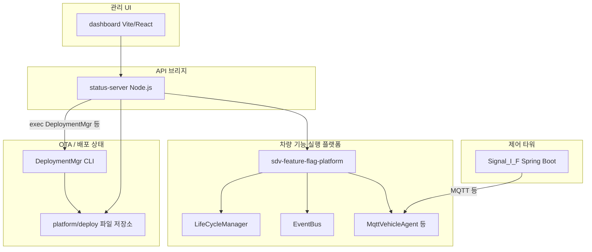

# SDV 배포·OTA·Fleet 아키텍처 개요

이 문서는 **코드 변경 없이** 팀과 교수진이 저장소 구조와 배포·OTA·Fleet·A/B·Shadow·Kill Switch 흐름을 이해할 수 있도록 정리한 참고 자료입니다. 경로·CLI는 현재 저장소 기준(`sdv-ota-manager/platform`)입니다.

---

## 1. 프로젝트 전체 구조



| 모듈 | 역할 |
|------|------|
| **sdv-feature-flag-platform** | SDV Feature(ADAS / Navigation / Energy) **실행** 플랫폼. LifeCycleManager, EventBus, CenterCommunication, MqttVehicleAgent 등으로 프로세스·이벤트·통신을 담당. |
| **sdv-ota-manager** | **OTA 배포 관리 전용**: `DeploymentMgr` CLI, `deploy/state`, `version_map`, 패키지·롤백 메타·Fleet 이력 등 **파일 기반** 상태 소스. |
| **status-server** | Dashboard와 `sdv-ota-manager/platform/deploy`·`DeploymentMgr`·Docker 데모 스크립트 사이를 잇는 **Node.js API**. Fleet 조회, 배포 호출, 패키지·버전맵·Unleash 프록시 등. |
| **dashboard** | 관리자 UI: Fleet·배포·패키지·Shadow/Kill 등 화면. |
| **Signal_I_F** | Spring Boot **제어 서버**: Kill Switch, Shadow, Deploy 요청을 REST로 받아 MQTT(`SdvControlTower` 등)로 차량 측에 전달하는 경로. |

---

## 2. `sdv-feature-flag-platform` vs `sdv-ota-manager` (핵심 차이)

| 구분 | sdv-feature-flag-platform | sdv-ota-manager |
|------|---------------------------|-----------------|
| **목적** | 차량에서 Feature를 **실제로 기동·전환·통신**하는 런타임 플랫폼 | 어떤 버전/슬롯/플래그로 배포할지 **기록·검증·CLI로 조정**하는 배포 관리 레이어 |
| **상태 소스** | 메모리, 설정 파일, EventBus, MQTT 메시지 등 **실행 중 상태** | `platform/deploy/` 아래 JSON·메타파일 (**디스크 상 배포 의도·이력**) |
| **대표 컴포넌트** | LifeCycleManager, Feature 바이너리/Docker 연동, MqttVehicleAgent | `DeploymentMgr`, `VehicleRegistry`, `VersionManager`, `StateManager` |

**정리**: OTA 매니저가 `deploy/state/car_N.json`에 “B 슬롯 v0.4로 올렸다”고 써도, 차량 런타임이 그 파일을 읽고 반영하는 연동은 **별도 파이프라인**(스크립트, status-server, 차량 쪽 적용 단계)에서 이뤄집니다. 반대로 Signal_I_F의 MQTT Kill/Shadow는 **런타임 제어 이벤트**에 가깝고, `fleet-kill` / `fleet-shadow`는 우선 **`deploy/state` 메타만 갱신**하는 경로입니다(코드 주석상 EventBus 연동은 향후 확장).

---

## 3. 배포 관리 핵심 파일 (`sdv-ota-manager/platform`)

실제 작업 디렉터리는 보통 **`sdv-ota-manager/platform`** 입니다. (`DeploymentMgr`는 여기서 상대 경로로 `deploy/`, `config/`를 탐색합니다.)

| 경로 | 설명 |
|------|------|
| **`deploy/version_map.json`** | Feature(ADAS / Navigation / Energy)별 **A/B 슬롯**에 매핑된 `version`, `role`(stable/candidate), `binary`. Fleet 배포 시 **허용 버전 검증** 등에 사용. |
| **`deploy/state/car_1.json` … `car_10.json`** | 차량별 **단일 진실 소스에 가까운 배포 상태**: Feature별 `active_slot`/`primary_*`, `pending_active_*`, `shadow_*`, `kill_switch`, `flag`, `rollback_stack`, `blocked_versions`, 차량 공통 **`ota`** 블록(`update_mode`, `driver_approved`, `gear`, `battery` 등). |
| **`deploy/package_registry.json`** | 패키지 목록 **인덱스**(UI/status-server와 정합). 개별 패키지 디렉터리와 함께 유지. |
| **`deploy/packages/<FEATURE>/<version>/`** | 패키지별 디렉터리. Docker 흐름에서는 **`manifest.json`**(`artifact_type`, `docker_image`, `checksum_file`, `image_digest` 등)과 `checksum.sha256` 등이 배치됨. |
| **`deploy/rollback/<car_id>/<FEATURE>.json`** | Fleet 배포 시점의 **롤백 메타데이터**(이전 슬롯/버전·동기화 여부 등). 배포 전 스냅샷 기록. |
| **`deploy/history/fleet_history.jsonl`** | Fleet 관련 액션 요약이 **JSON Lines**로 누적되는 파일(문서·코드 기준 경로). *(루트 `deploy/fleet_history.jsonl`이 아님)* |
| **`config/fleet/vehicles.json`** | Fleet **레지스트리**: `car_id`, `group`(canary 등), `region`(KR 등), 모델 등. `DeploymentMgr`가 group/region 타깃팅 시 사용. |

---

## 4. Fleet / Vehicle / Group / Region / Campaign

프로젝트 코드·설정 기준 정의:

- **Fleet**: 관리 대상 차량 전체. 데모에서는 `vehicles.json` + `deploy/state/car_*.json` 집합으로 모델링.
- **Vehicle**: `car_1` … `car_10` 등 개별 차량 ID.
- **Group**: `vehicles.json`의 `group` 필드 (예: **canary**, beta, stable). `fleet-deploy group …` 에 매칭.
- **Region**: `vehicles.json`의 `region` 필드 (예: **KR**, US). `fleet-deploy region …` 또는 `group_region` 조합에 사용.
- **Campaign**: 코드에 단일 클래스 이름으로 고정된 용어는 아니지만, 운영 관점에서는 **특정 Feature·슬롯·버전을 선택한 Fleet 서브집합(vehicle / group / region / group+region)에 적용하는 한 번의 배포 작업**을 의미합니다. CLI에서는 `fleet-deploy` 한 번 호출 + 선택적 `--sync-config`, 이력은 `fleet_history.jsonl` 등에 남습니다.

---

## 5. A/B Slot

- **`version_map.json`**: 각 Feature마다 **A**, **B** 두 슬롯이 있으며, 일반적으로 **A = stable**, **B = candidate** 역할입니다.
- **A/B는 Shadow와 다릅니다.** A/B는 “버전 슬롯(레거시 실행파일·버전 맵 선택자)”이고, Shadow는 **별도 필드**(`shadow_enabled`, `shadow_slot`, `shadow_version` 등)로 후보를 **검증 전용**으로 올려두는 패턴입니다.
- **B(candidate)**를 곧바로 **primary/active**로 배포할 수도 있고(`fleet-deploy`로 슬롯 B·버전 허용), **Shadow만 켜서** 검증만 할 수도 있습니다(`fleet-shadow`).

---

## 6. Shadow Mode 흐름 (파일 상태 기준)

1. **Primary(또는 legacy 명칭 active*)** 슬롯/버전은 운행 중 “실사용” 선택으로 유지.
2. **`fleet-shadow vehicle <car_id> <FEATURE> ON`** 시 `deploy/state`에 Shadow 관련 필드가 기록되고, ON일 때 **슬롯 B의 버전은 `version_map.json`에서 해석**되는 패턴이 문서화되어 있습니다(실제 필드는 JSON의 `shadow_*` 블록).
3. Shadow는 **제어/운행의 단일 소스가 아니라 검증·대조용** 메타로 두고, 검증이 끝나면 **`fleet-promote-shadow vehicle <car_id> <FEATURE>`** 로 메타데이터 상 승격(rollback_stack 등과 함께 다룸). Docker 런타임에서 컨테이너 전환까지 하려면 저장소의 **`scripts/ota_vehicle.sh`** 등 별도 스크립트 경로를 사용합니다.

---

## 7. Kill Switch 흐름

### 설계 의도 (도메인별)

- **ADAS**: 안전 필수 → Kill 시 도메인 **OFF** 또는 **stable fallback** 중심 정책(상태 필드·플래그 조합으로 표현).
- **Navigation**: 전체 내비를 끄기보다 **위험한 sub-feature**(예: realtime route 등)만 **플래그로 비활성화**하는 방향이 상태 모델에서 허용됨(`realtime_route_flag` 등).
- **Energy**: 배터리 코어는 유지하고 **advanced 기능만** 플래그로 내리는 방향(`advanced_range_flag` 등).

### 구현 상 분리

- **`DeploymentMgr fleet-kill vehicle …`**: `deploy/state`에 `kill_switch`, `kill_reason`, fallback 등을 기록. 주석상 **EventBus와의 실시간 연동은 향후 과제**.
- **Signal_I_F**: HTTP API로 Kill/Shadow/Deploy를 받아 **MQTT 메시지**로 차량 측에 전달하는 **제어 타워** 역할.

운영 문서에서는 두 경로가 **같은 목적을 다른 레이어에서 수행**할 수 있음을 구분해 설명하는 것이 좋습니다.

---

## 8. OTA 배포 흐름 (`deployToVehicleInternal` 기준)

대표 순서(데모는 한 호출 안에서 단계를 빠르게 기록):

1. **패키지 등록**: `deploy/packages/…` 및 `package_registry.json` 정합.
2. **Version map**: A/B에 허용된 버전·바이너리 정의 (`version_map.json`).
3. **Fleet deploy 실행**: `fleet-deploy` 또는 단일 차량 배포 경로.
4. **Safety check**: `checkOtaSafety()` — online, PARKED, ignition OFF, `update_mode == READY`, 기어 P, 속도 0, 주차브레이크 ON, 배터리 ≥ 30, **driver_approved**, 네트워크 CONNECTED, target_system_running false 등.
5. **Downloading**: OTA 필드에 DOWNLOADING 등 기록 + `ota_phase`.
6. **Metadata verification**: 패키지에 `manifest.json`이 있으면 **Docker 메타** 검증(`docker_image`, `checksum_file` 또는 `image_digest`, 파일 존재 등). 실패 시 원인을 로그/실패 사유로 상세화.
7. **Ready to install**: 검증 통과 후 READY_TO_INSTALL 단계 기록.
8. **Installing**: installing / target_system_running 등 전환.
9. **Completed**: 설치 완료·`update_mode` COMPLETED 등.
10. **Rollback metadata**: 배포 전 스냅샷을 `deploy/rollback/…`에 기록.
11. **Fleet history**: 요약 JSON을 `deploy/history/fleet_history.jsonl` 등에 append.

---

## 9. `fleet-selftest`

### 실행 방법

작업 디렉터리는 **`sdv-ota-manager/platform`** 이어야 합니다.

```bash
cd sdv-ota-manager/platform/DeploymentManager
cmake -S . -B build
cmake --build build

cd ..
./DeploymentManager/build/DeploymentMgr fleet-selftest
```

Windows에서는 빌드 출력에 따라 `DeploymentMgr.exe` 경로가 `build/Release/` 일 수 있습니다.

### 성공 기준

- 표준 출력 마지막에 **`[SELFTEST] SUCCESS`** 가 나오면 통과입니다.
- 테스트는 디스크의 차량 상태가 망가져 있어도, 시작 시 **안전 조건에 맞는 OTA baseline**을 canary+KR 대상에 쓰고, 종료 시 **원본 스냅샷으로 복구**합니다.

### 검증 시나리오 요약

| 시나리오 | 내용 |
|----------|------|
| Registry | `vehicles.json`에서 canary+KR 타깃이 `car_1`, `car_10` 두 대인지 확인. |
| Version map | `version_map.json` 시맨틱(A/B, stable/candidate, 바이너리명) 및 ADAS B 버전을 읽어 배포 인자로 사용. |
| OTA safety | 준비된 baseline으로 `checkOtaSafety` 통과 확인 후, **driver_approved=false** 이면 배포 실패·OTA 필드 불변. |
| Deploy 성공 | **driver_approved=true** 이면 ADAS 슬롯 B·`version_map`의 후보 버전(예: v0.4)으로 배포 성공·상태 갱신. |
| Group+region summary | 한 대는 승인·한 대는 미승인으로 두고 **요약에서 성공 1 / 실패 1**, 실패 사유에 driver approval 관련 문자열 포함 확인. |
| Zero targets | 존재하지 않는 group으로 배포 시 **total=0**, `no target vehicles` 처리 확인. |

---

## 10. 자주 쓰는 `DeploymentMgr` 명령 예시

플랫폼 루트(`sdv-ota-manager/platform`)에서:

```bash
# 단일 차량 Fleet 배포 (예)
./DeploymentManager/build/DeploymentMgr fleet-deploy vehicle car_1 ADAS B v0.4

# 그룹 + 리전
./DeploymentManager/build/DeploymentMgr fleet-deploy group_region canary KR ADAS B v0.4

# 운전자 승인 플래그
./DeploymentManager/build/DeploymentMgr fleet-set-approval car_1 true

# Shadow / 승격 / Kill (상태 파일 기준)
./DeploymentManager/build/DeploymentMgr fleet-shadow vehicle car_1 ADAS ON
./DeploymentManager/build/DeploymentMgr fleet-promote-shadow vehicle car_1 ADAS
./DeploymentManager/build/DeploymentMgr fleet-kill vehicle car_1 ADAS lane_detection_error
```

자세한 서브커맨드는 다음에서 확인할 수 있습니다.

```bash
./DeploymentManager/build/DeploymentMgr
```

(인자 없이 실행 시 사용법 출력)

---

## 11. 관련 읽을 거리 (저장소 내)

- `sdv-ota-manager/platform/deploy/README_DOCKER_PACKAGES.md` — Docker 패키지 `manifest.json` 권장 필드.
- `sdv-ota-manager/platform/deploy/README_DEPLOY_LAYOUT.md` — 디렉터리 레이아웃.
- `sdv-feature-flag-platform/status-server/server.js` 상단 주석 — `PLATFORM_DEPLOY_ROOT`, Docker 데모 스크립트 경로.

---

*문서 버전: 저장소 현재 구조 기준 정리. CLI/경로는 배포 환경에 맞게 조정하세요.*
