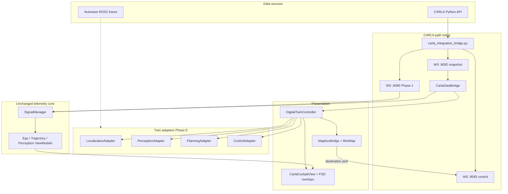
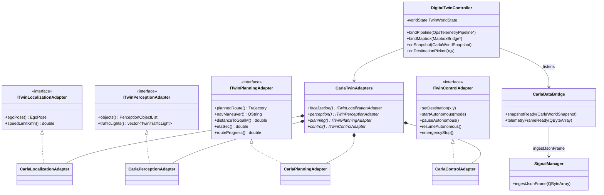

# SDV Digital Twin Architecture

Hyundai SDV Operations Center — CARLA today, Autoware tomorrow.  
**Telemetry pipeline is frozen:** `RosBridgeClient` → `SignalManager::ingestJsonFrame` → ViewModels.

All twin-specific data flows through **adapter interfaces** and optional parallel paths (`DigitalTwinController`, `ingestJsonFrame` with existing envelope types only).

---

## Layered architecture



---

## Class diagram (C++ twin layer)



---

## Phase mapping

| Phase | Deliverable | Pipeline impact |
|-------|-------------|-----------------|
| **A** Full CARLA | Python ego/traffic/peds/lights/speed; `traffic_light` in `perception_objects` | None — same envelopes |
| **B** Route planning | Mapbox click → control WS → GRP route → `trajectory` + map GeoJSON | None |
| **C** Autonomous | BasicAgent / BehaviorAgent; Start/Pause/Resume via control WS | None |
| **D** Visualization | FSD overlays + `TrafficLightOverlayRenderer` + twin HUD fields | None |
| **E** Autoware | `ITwin*Adapter` stubs; swap `CarlaTwinAdapters` → `AutowareTwinAdapters` | None |

---

## Ports

| Port | Protocol |
|------|----------|
| 2000 | CARLA RPC |
| 9090 | Phase-1 telemetry + camera |
| 9092 | `carla_snapshot` (rich twin metadata) |
| 9093 | `carla_control` + `carla_status` |

---

## Integration guide

### 1. Start CARLA + bridge

```bash
# Terminal 1 — CARLA 0.9.15
CarlaUE4.exe

# Terminal 2
cd sdv-operations-center/scripts
python carla_integration_bridge.py
# Expect: Connected to CARLA — map Town10HD
#          CARLA Control Center v2 + Digital Twin sensors
```

### 2. Dashboard

```bash
sdv-dashboard-qt/build/Release/SDV_Dashboard.exe --carla-mode bridge
```

- **Shift+click** on minimap → destination (local X/Y → CARLA route).
- **AUTONOMOUS** panel: Start / Pause / Resume / E-STOP.
- Cockpit focus → WASD manual drive when autonomy off.

### 3. Modes

| `--carla-mode` | Twin source |
|----------------|-------------|
| `bridge` | Python → 9090 ingest + 9093 control |
| `carla-ws` | 9092 snapshot → C++ bridge → ingest |
| `sim` | C++ sim + local control (no CARLA) |

### 4. Switching to Autoware (future)

1. Implement `AutowareTwinAdapters` (subscribe ROS2 → same `ITwin*` outputs).
2. In `MainWindow`, replace `CarlaTwinAdapters` factory with Autoware factory.
3. **Do not** change `SignalManager`, ViewModels, or overlay widgets.

---

## Snapshot JSON extensions (`carla_snapshot.data`)

```json
{
  "vehicle": { ... },
  "actors": [ ... ],
  "traffic_lights": [ { "id", "state", "position", "yaw_rad" } ],
  "speed_limit_kmh": 50,
  "autonomy": { "mode": "behavior", "state": "driving", "maneuver": "lane_follow" },
  "navigation": { "remain_m", "eta_sec", "progress", "arrow" },
  "trajectory_points": [ ... ]
}
```

Traffic lights are duplicated into `perception_objects` as `classification: "traffic_light"` for overlay compatibility.
